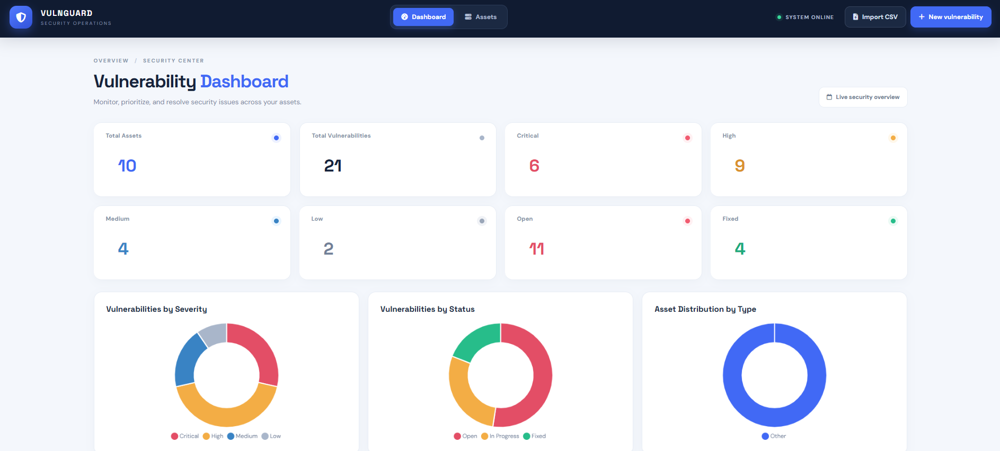

VulnGuard – Vulnerability Management System

"Python" (https://img.shields.io/badge/Python-3.11-blue)
"Flask" (https://img.shields.io/badge/Flask-3.0-black)
"Database" (https://img.shields.io/badge/Database-SQLite-blue)
"Status" (https://img.shields.io/badge/Status-Development-orange)
"License" (https://img.shields.io/badge/License-MIT-green)

Overview

VulnGuard is a web-based Vulnerability Management System built with Python and Flask. It provides a centralized dashboard for managing vulnerabilities, tracking affected assets, and monitoring security risks.

The project aims to make vulnerability tracking and assessment easier through a simple and organized interface.

Screenshots

Features

Vulnerability Management

- Add and manage vulnerability records.
- Track vulnerability severity and status.
- View vulnerability details.

Asset Management

- Organize and track affected assets.
- Associate vulnerabilities with assets.

Security Dashboard

- View vulnerability statistics.
- Monitor security status.
- Visualize vulnerability severity distribution.

Additional Features

- CSV import support.
- Dashboard charts.
- API endpoints for application data.

Web Vulnerability Scanner (Phase 3, scanner package)

- Security headers detection (missing or misconfigured HTTP security headers).
- Cookie security detection (Secure, HttpOnly and SameSite attributes).
- Passive SSL/TLS security detection (certificate verification failures and obsolete negotiated protocols).
- The scanner is implemented as a Python package (scanner/). It is not yet connected to the Flask application, dashboard or API. See Scanner Capabilities below.

Scanner Capabilities

The scanner/ package crawls an authorized target and runs passive detectors over the responses it has already collected. Detectors are plug-ins registered in scanner/detectors/, and every finding is built from a rule in scanner/rules/catalog.py (title, severity, confidence, reference and remediation).

Implemented

Security Headers Detection

- Missing or misconfigured Content-Security-Policy (missing, report-only, malformed, meta-only or late meta, unsafe directives).
- Missing or weak Strict-Transport-Security (HSTS).
- Missing or invalid X-Content-Type-Options.
- Missing or weak clickjacking protection (X-Frame-Options and CSP frame-ancestors).
- Missing or weak Referrer-Policy.
- Missing Permissions-Policy.

Cookie Security Detection

- Cookies set without the Secure attribute.
- Cookies set without the HttpOnly attribute.
- Missing SameSite attribute, SameSite=None, and SameSite=None without Secure.
- Related checks: invalid __Secure-/__Host- prefixes, overly broad Domain attributes, sensitive-looking cookies over HTTP, Secure cookies set over HTTP, and malformed cookie names.
- Cookie values are not stored in findings.

Passive SSL/TLS Security Detection

- Certificate verification failures: expired, not yet valid, hostname mismatch, self-signed, and untrusted or incomplete certificate chains. Other verification errors are reported as an invalid certificate with the verifier's message.
- Obsolete negotiated protocols: SSLv2, SSLv3, TLS 1.0 and TLS 1.1 are reported when the connection the scanner made actually negotiated one of them.
- When a connection negotiated TLS 1.2 or 1.3, the scanner reports an informational note that legacy protocol support was not tested.
- Passive only: the TLS detector uses existing scan observations (the certificate verification result and negotiated protocol version of requests the crawler already made). It does not perform additional TLS handshakes or send additional network requests.
- Trust-chain results come from the scanner host's own trust store, so they are reported with lower confidence than certificate problems that are intrinsic to the certificate (such as expiry). The scanner's TLS client does not offer TLS 1.0/1.1, so a server that merely accepts them is not detected.

Scan limits and safety

- A scan needs an explicit authorization flag, and the target must be allowed by the scan allowlist (VULNGUARD_SCAN_ALLOWLIST).
- Fixed limits in scanner/config.py: crawl depth 2, 20 pages, 100 requests per scan, at most 2 requests per second.
- Finding evidence is redacted and URLs are sanitized before output.

Not yet implemented

- Integration of the scanner into the Flask application (no scan routes, dashboard pages or UI yet).
- Information disclosure and security configuration detectors (rules are defined in the catalog, but no detectors run them yet).
- TLS rules that are defined in the catalog but have no detector yet: certificate expiring soon, HTTP without redirect to HTTPS, HTTP-only sites, and login over HTTP.
- Active probing of legacy TLS protocol support.

Tech Stack

- Backend: Python, Flask
- Frontend: HTML, CSS, JavaScript, Bootstrap
- Database: SQLite
- Charts: Chart.js

Project Structure

VulnGuard/
│
├── app.py
├── requirements.txt
├── requirements-dev.txt
├── README.md
├── screenshots/
│   └── dashboard.png
│
├── templates/
├── static/
├── scanner/
│   ├── detectors/
│   └── rules/
├── tests/
└── database/

The actual folder structure may vary depending on the project version.

Installation

1. Clone the Repository

git clone https://github.com/abdo0011/vulnGurard.git

2. Navigate to the Project Directory

cd vulnGurard

3. Install Dependencies

pip install -r requirements.txt

4. Run the Application

python app.py

5. Open in Your Browser

http://127.0.0.1:5000

How It Works

1. Launch the VulnGuard web application.
2. Access the dashboard to review vulnerability statistics.
3. Add or import vulnerability records.
4. Manage assets and track associated vulnerabilities.
5. Monitor vulnerability severity and status through the dashboard.

Testing

The scanner has an automated test suite (pytest). Install the development dependencies and run it from the project root:

pip install -r requirements.txt -r requirements-dev.txt

python -m pytest

Latest reported result (after Phase 3 Feature 3, commit ae9776d): 1608 passed.

The cryptography package in requirements-dev.txt is used only by the TLS handshake tests to generate test certificates. It is not used by the scanner itself.

Severity Classification

Severity| Description
Critical| Highest priority security risk
High| Significant security risk
Medium| Moderate security risk
Low| Lower-level security risk
Informational| Information that may require attention

Project Goals

- Simplify vulnerability tracking.
- Provide a centralized vulnerability management interface.
- Improve visibility into security risks.
- Support organized vulnerability assessment workflows.

Future Improvements

- User authentication and role management.
- Advanced filtering and search.
- Detailed vulnerability reports.
- More security assessment integrations.
- Connect the scanner to the Flask application (scan requests, results in the dashboard).
- Additional scanner detectors (information disclosure, security configuration).
- Improved dashboard analytics.
